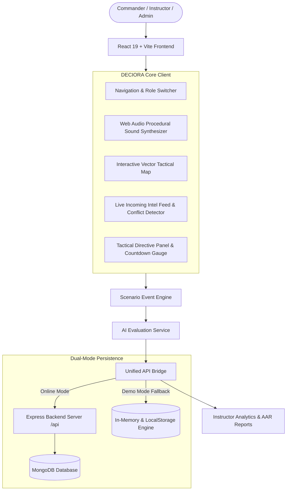

# DECIORA — Decision-Making Under Uncertainty
### PS26048 Degraded Communication Decision-Making Training Simulator

> **DECIORA** is a professional, responsive, web-based military-inspired decision-making training simulator prototype designed for **PS26048**.
>
> ⚠️ **Important Constraint & Safety Statement:**
> DECIORA does **NOT** simulate real-world warfare tactics, targeting instructions, weapon deployment procedures, or real military bases. Its sole objective is to train, evaluate, and debrief **human cognitive decision-making under uncertainty, incomplete information, transmission latency, conflicting intelligence, and communication blackouts** using fictional sectors and abstract tactical elements.

---

## 1. Problem Statement (PS26048)

In high-consequence operational environments, decision failures rarely stem from equipment breakdowns—they occur when communications deteriorate. Under transmission latency, sensor divergence, and electronic blackout:
- Commanders face conflicting field reports (e.g., ground observers report movement East, while automated airborne sensors detect signatures North).
- Critical reports arrive with 10–45 second latency delays.
- Downlinks experience packet loss and total signal blackout.
- Commanders frequently fall prey to **hindsight bias** or freeze under time pressure.

Traditional training platforms evaluate outcomes with hindsight rather than evaluating **the rationality and defensibility of the decision given the exact information available at the moment it was committed**.

---

## 2. The Solution: DECIORA Platform

DECIORA provides an end-to-end tactical command simulator and cognitive evaluation engine:
1. **Live Scenario Engine:** Real-time event progression injecting delayed reports, conflicting intelligence, and signal degradation.
2. **Degradation System (4 Levels):**
   - **Level 1 (Normal):** 100% signal, immediate, reliable telemetry.
   - **Level 2 (Mild):** 74% signal, 5–15s transmission delay.
   - **Level 3 (Moderate/Unstable):** 42% signal, packet loss, sensor discrepancies.
   - **Level 4 (Severe Blackout):** 0–15% signal, total link severance.
3. **Interactive Tactical Vector Map:** Fictional Sector Delta-9 (River Kestrel, Bridge Alpha, Village Orin, Checkpoint Bravo, Relay Tower A4, Friendly Vanguard Team, UAV Falcon, and pulsing Uncertainty Zones with question-mark contact bubbles).
4. **Multi-Axial Scoring Model (100 Points):**
   - **Decision Quality (30 pts):** Grounded in available information at decision time (no hindsight bias).
   - **Information Usage (20 pts):** Cross-referencing conflicting telemetry before maneuvering.
   - **Risk Management (20 pts):** Force protection and avoiding reckless blind exposure.
   - **Decision Speed (15 pts):** Cognitive pacing under operational deadlines.
   - **Communication Protocol (15 pts):** Adherence to contingency doctrines during signal loss.
5. **AI Decision Evaluation Service (`aiEvaluator.js`):** Diagnoses cognitive strengths, areas of vulnerability, and actionable tactical recommendations.
6. **After Action Review (AAR) & Decision Replay:** Chronological event reconstruction with interactive timeline scrubber, clickable event telemetry inspect, and persistent commander reflection logs.
7. **Instructor Command Center:** Cohort oversight, degradation-vs-score analytics, 5-axis competency radar charts, and individual officer profile drawers.

---

## 3. System Architecture



---

## 4. Tech Stack

- **Frontend:** React 19, Vite 8, Vanilla CSS Design System with CSS Custom Property Tokens.
- **Visuals & HUD:** Custom Command-Center dark mode (`#07111F`, `#0D1B2A`, `#12263A`, accents `#38BDF8`, `#22C55E`, `#F59E0B`, `#EF4444`).
- **Icons:** `lucide-react` (military and tactical symbology).
- **Charts:** `recharts` (Area charts, Bar charts, Radar competency charts).
- **Tactical Map:** Custom SVG Vector Tactical Map engine with coordinate grid, sector contours, animated radar sweeps, and uncertainty overlays.
- **Audio Synthesizer:** Pure Web Audio API (`soundSystem.js`) procedural sound generator (clicks, teletype chimes, warning klaxons, and connection restored alerts with mute toggle).
- **Backend API:** Express 5, CORS, JSON Web Tokens (JWT), Dotenv.
- **Database & Models:** MongoDB + Mongoose models (`User`, `Scenario`, `TrainingSession`, `AARReport`, `PerformanceMetric`) + Autonomous In-Memory fallback.

---

## 5. How to Demo DECIORA (For Judges & Evaluators)

The application features an **autonomous demo mode** that runs immediately with zero required external database configuration:

1. **Launch the application:**
   ```bash
   npm run dev
   ```
   Open `http://localhost:5173/` in your browser.

2. **Landing Page:**
   - Observe the dark command-center aesthetics, telemetry scanlines, and animated HUD preview.
   - Click **`[START TRAINING]`** or use the **⚡ Quick Demo Access** buttons to switch between **Commander Alpha**, **Instructor Vance**, or **System Admin**.

3. **Scenario Selection:**
   - Browse the 4 distinct scenarios:
     1. *Scenario 01: Strategic Bridge* (Moderate Degradation & Intermittent Relay Delay)
     2. *Scenario 02: Communication Blackout* (Total Signal Severance)
     3. *Scenario 03: Conflicting Reports* (Sensor Discrepancy & Acoustic Decoy)
     4. *Scenario 04: Incomplete Intelligence* (Terrain Masking & Cloud Occlusion)
   - Click **`START SIMULATION`** on *Strategic Bridge*.

4. **Training Simulation:**
   - Watch the **Mission Clock** advance (`T+00:15`, `T+00:30`, etc.).
   - Notice incoming intel reports arriving with timestamps, delay tags (e.g. `+14s delay`), and confidence meters.
   - At T+25s, observe the downlink degrade to **Level 2 (Mild)**.
   - At T+50s, observe **`⚠ CONFLICTING REPORTS DETECTED`** appear when Ground Patrol Vanguard and Air Sensor Raven submit opposing directional vectors.
   - At T+65s, observe the link drop to **Level 3 (Unstable)** and Recon Falcon lose signal.
   - When the **Command Directive** panel activates with the 30-second countdown, choose **`[B] Request UAV Falcon Reconnaissance`** (verifies conflicting reports before moving ground troops).
   - Click **`CONFIRM TACTICAL DECISION`**, review the confirmation modal, and click **`Transmit Order Now`**.

5. **Mission Results & AI Debrief:**
   - Inspect the **Composite Readiness Score** (e.g. `87/100`).
   - Examine the 5-axis competency breakdown:
     - Decision Quality (no hindsight bias)
     - Information Usage
     - Risk Management
     - Decision Speed
     - Communication Protocol
   - Read the qualitative **AI Feedback Card** detailing observed strengths, areas to refine, and concrete tactical recommendations.

6. **After Action Review (AAR):**
   - Click **`OPEN AFTER ACTION REVIEW (AAR)`**.
   - Drag the **Interactive Timeline Scrubber** to inspect the state at any second of the scenario.
   - Click individual event nodes to see what was known vs what was delayed/missing at that exact moment.
   - Fill in the **Commander Self-Reflection** questions and click **`Save AAR Self-Reflection`**.
   - Click **`Export AAR Data (JSON)`** to download the complete session audit.

7. **Instructor Command Center:**
   - In the top navigation bar, click **`Instructor Center`**.
   - Review executive cohort metrics across 48 trainees.
   - Inspect the **Score By Communication Degradation Level** chart and **Competency Radar Chart**.
   - Click any officer in the roster (e.g., *Officer Alpha* or *Officer Delta*) to open their detailed cognitive profile drawer.

---

## 6. Running Locally

### Prerequisites
- Node.js v18+ (tested on v22)
- npm v9+

### Installation
```bash
# Clone or navigate to the directory
cd d:/DECIORA

# Install dependencies
npm install
```

### Running Frontend Only (Autonomous Demo Mode)
```bash
npm run dev
# Vite dev server runs at http://localhost:5173/
```

### Running Backend API
```bash
npm run server
# Express server runs at http://localhost:5000/
```

### Running Full-Stack (Frontend + Backend concurrently)
```bash
npm run fullstack
```

---

## 7. Project Structure

```text
DECIORA/
├── public/
├── src/
│   ├── components/
│   │   ├── layout/
│   │   │   └── Navbar.jsx              # Command header & role switcher
│   │   ├── simulator/
│   │   │   ├── CommandHeader.jsx       # Mission clock, speed, comm health
│   │   │   └── MissionSidebar.jsx      # Directives & unit telemetry
│   │   ├── map/
│   │   │   └── ScenarioMap.jsx         # Tactical vector map & uncertainty
│   │   ├── reports/
│   │   │   └── InformationFeed.jsx     # Live intel stream & conflict alerts
│   │   └── decisions/
│   │       └── DecisionPanel.jsx       # Multi-choice directives & countdown
│   ├── pages/
│   │   ├── Landing.jsx                 # Public portal & value proposition
│   │   ├── Login.jsx                   # Role-based credentials & 1-click demo
│   │   ├── Dashboard.jsx               # Commander readiness & performance chart
│   │   ├── Scenarios.jsx               # Catalog of 4 tactical scenarios
│   │   ├── Simulator.jsx               # State machine simulation orchestrator
│   │   ├── Results.jsx                 # AI evaluation debrief & score axes
│   │   ├── AAR.jsx                     # Interactive timeline scrubber & reflection
│   │   ├── Leaderboard.jsx             # Top commanders & accuracy rankings
│   │   ├── History.jsx                 # Training session archives
│   │   └── InstructorDashboard.jsx     # Cohort analytics, radar & officer profiles
│   ├── services/
│   │   ├── api.js                      # Dual-mode API & mock engine bridge
│   │   ├── mockData.js                 # 4 Scenarios, demo users, cohort data
│   │   ├── aiEvaluator.js              # Multi-axial decision scoring model
│   │   └── soundSystem.js              # Web Audio procedural sound synthesizer
│   ├── App.jsx                         # Main client routing controller
│   ├── index.css                       # Complete Vanilla CSS command design tokens
│   └── main.jsx                        # React root entry
├── server/
│   ├── models/
│   │   ├── User.js                     # Commander / Instructor user schema
│   │   ├── Scenario.js                 # Fictional scenario configuration schema
│   │   ├── TrainingSession.js          # Completed simulation result schema
│   │   ├── AARReport.js                # Self-reflection questionnaire schema
│   │   └── PerformanceMetric.js        # Degradation cognitive latency schema
│   └── index.js                        # Express server with MongoDB/Memory fallback
├── .env.example                        # Environment variable specifications
├── package.json
└── README.md
```

---

## 8. License & Attribution

Designed and engineered for **PS26048: Degraded Communication Decision-Making Training Simulator**. Abstract non-combat training simulation. All tactical scenarios and geographic names are entirely fictional.
